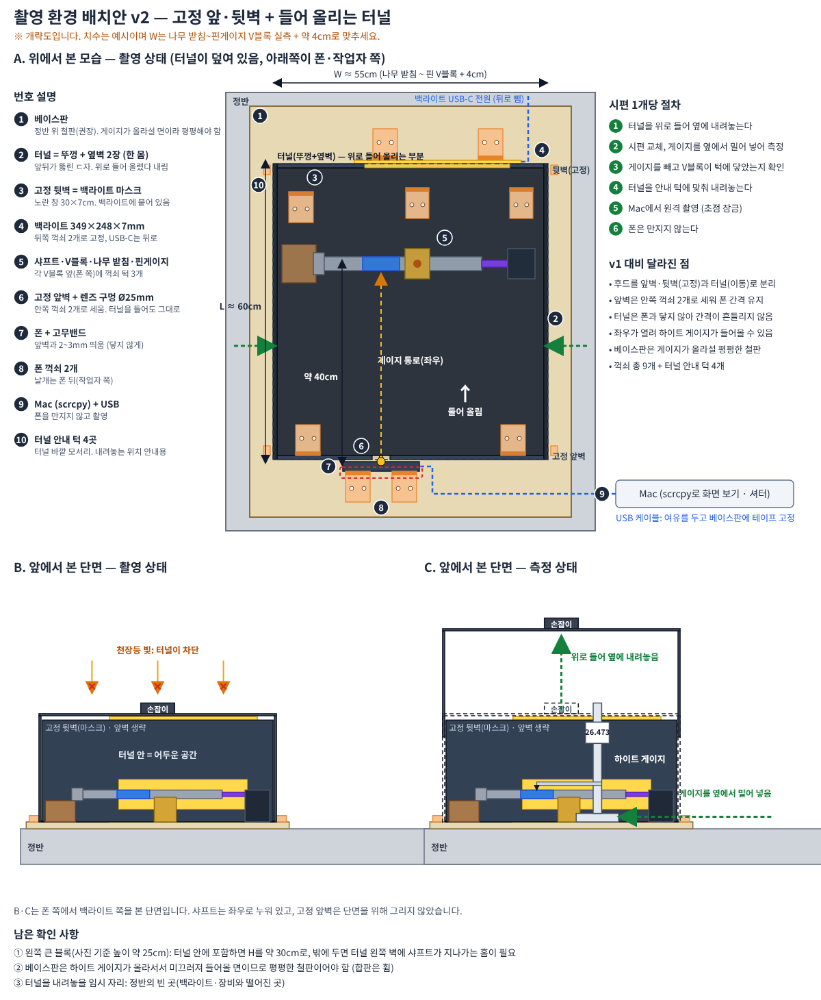
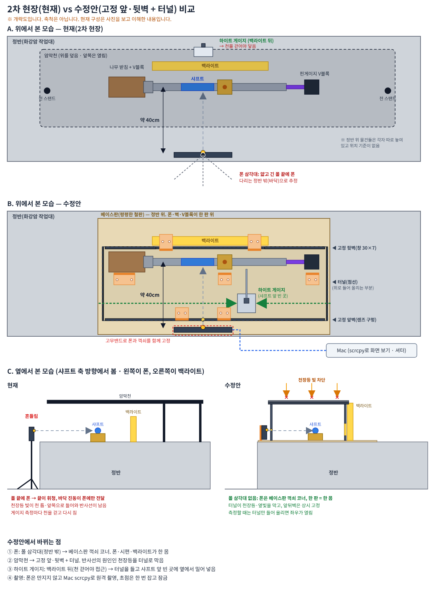
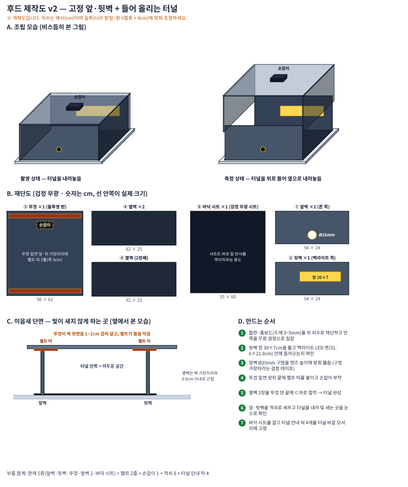
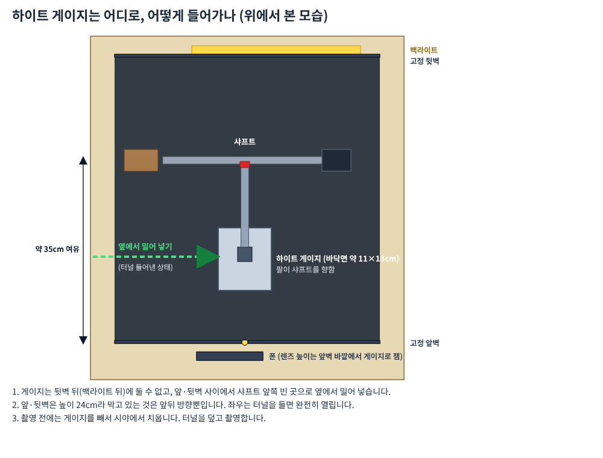

# 촬영 후드(터널식) 제작·적용 계획

Oct 14, 2026 · @이다겸

앞·뒷벽은 고정하고 위의 터널만 들어 올리는 후드로 천장등 반사를 막고, 시편마다 하이트 게이지를 옆에서 넣어 잽니다.

*배치도 v2: 위에서 본 촬영 상태(A), 앞에서 본 단면의 촬영 상태(B)와 터널을 들어 게이지를 넣는 측정 상태(C)*

## 현재(2차 현장)와 수정안 비교

2차 현장은 폰을 정반 밖 폴 삼각대에 두고, 암막천으로 위를 덮었습니다. 수정안은 폰·벽·V블록을 베이스판 한 판에 고정하고, 천 대신 터널을 씁운니다.

*A는 사진을 보고 이해한 2차 현장, B는 수정안(위에서), C는 두 구성을 옆에서 본 모습*

| 항목 | 현재(2차 현장) | 수정안 |
| --- | --- | --- |
| 폰 고정 | 정반 밖 폴 삼각대. 끝이 휘청거리고 바닥 진동이 폰에만 전달됨 | 베이스판 꺽쇠 코너. 폰·시편·백라이트가 한 뫸 |
| 물건 위치 | 정반 위에 각자 놓인 상태, 위치 기준 없음 | 꺽쇠 턱으로 매번 같은 자리 |
| 빛 차단 | 암막천(스탠드 지지). 천 틈·앞쪽으로 빛이 들어와 반사선이 남음 | 고정 앞·뒷벽 + 터널. 천장등을 위에서 막고 펠트로 틈을 막음 |
| 하이트 게이지 | 백라이트 뒤에 있어 천을 걷어야 닿음 | 터널을 들고 샤프트 앞 빈 곳에 옆에서 밀어 넣음 |
| 시편마다 하는 일 | 천을 걷고 다시 침. 반복 동작 오차 가능 | 터널을 들었다 안내 턱에 맞춰 내림. 폰과 벽은 안 만짐 |
| 촬영 | 폰 조작 | Mac scrcpy 원격 촬영, 초점 잠금 |

## 구성

치수(cm)는 예시입니다. 폭 W는 나무 받침부터 핀게이지 V블록까지 실측한 길이에 약 4cm를 더해 정합니다. 판재는 합판 또는 폼보드 3\~5mm이고, 안쪽은 무광 검정입니다.

| 부품 | 수량 | 치수(cm) | 역할 |
| --- | --- | --- | --- |
| 고정 앞벽 | 1 | 54 × 24, 렌즈 구멍 Ø2.5 | 폰 바로 앞에 서서 폰과의 간격을 고정하고, 앞쪽 천장등 빛을 막음 |
| 고정 뒷벽(마스크) | 1 | 54 × 24, 창 30 × 7 | 백라이트에 붙여 빛이 나오는 창만 남김. 창은 LED 면(31.6 × 21.8) 안에 들어와야 함 |
| 터널 뚜껑 | 1 | 56 × 62 | 천장등 빛을 위에서 차단. 손잡이 부착 |
| 터널 옆벽 | 2 | 62 × 25 | 좌우 빛 차단. 뚜껑 양 끝에 ㄷ자로 접착 |
| 바닥 시트 | 1 | 55 × 60 | 샤프트 아래 반사를 흡수하는 무광 검정 시트 |
| 펠트 띠 | 2줄 | 폭 3 | 뚜껑 밑면 앞·뒤 끝. 벽 윗면과의 틈을 막음 |
| 터널 안내 턱 | 4 | 약 2.3 × 1.5 | 터널 바깥 모서리에 고정. 내려놓는 위치를 매번 같게 함 |
| 꺽쇠 | 9 | 시판 L자 브래킷 | 폰 2, 앞벽 안쪽 2, V블록 턱 3, 백라이트 2 |
| 베이스판 | 1 | 약 65 × 75, 두께 6mm 이상(위 베이스판 제작 참고) | 평평한 철판. 하이트 게이지가 올라설 면 |

*제작도 v2: 조립 모습, 재단도, 이음새 단면, 만드는 순서*

## 베이스판 제작

베이스판은 폰, 앞벽, 뒷벽(백라이트), V블록 턱을 한 판 위에 고정해 상대 위치를 바꾸지 않게 하는 부품이고, 하이트 게이지가 올라서는 바닥이기도 합니다. 두 역할 때문에 재료는 직선자를 대면 빈 틈이 없는 평평한 철판이어야 합니다.

| 항목 | 기준(예시) | 이유 |
| --- | --- | --- |
| 재료 | 철판(자석이 붙는 강철), 두께 6mm 이상 | 마그네틱 V블록과 자석 고정을 쓸 수 있고, 게이지 하중에 휘지 않음 |
| 크기 | 약 65 × 75 | 후드 55 × 60 + 터널 안내 턱 여유(좌우 각 4) + 폰 브래킷 자리(앞쪽 약 10–15) |
| 무게 | 6mm이면 약 23kg | 무거워서 게이지를 밀어도 움직이지 않지만, 옮기기 불편함 |
| 평면도 | 게이지 오차(±0.04mm) 이내 | 게이지 읽기값이 위치마다 달라지면 안 됨 |

1. 현장 확인 사항 #3으로 평평한 철판이 있는지 본다. 없으면 절단·연사 가공이 되는 업체에 6mm 철판을 크기대로 주문한다(표면 연사 옵션 확인).
2. 정반 위에 올려 흔들리지 않는지 본다. 모서리를 눌러 달그락거리면 고무 발 3개로 받쳐 세 점 지지로 만든다(네 점이면 흔들림).
3. 평면도를 확인한다. 하이트 게이지를 판 위 다섯 곳(네 모서리와 중앙)에 올려 같은 높이의 기준면을 재고, 편차가 게이지 오차 이내인지 본다.
4. 판 위에 마킹테이프로 위치를 그린다: 앞벽 선, 뒷벽(백라이트) 선, V블록 3개 자리, 폰 브래킷 자리, 터널 안내 턱 4곳, 게이지 구역(샤프트 앞 11 × 13cm 이상 + 여유).
5. 꺽쇠 9개를 고정한다. 구멍을 뚫을 수 있으면 M4 볼트와 너트로, 아니면 강한 양면테이프나 자석으로 붙이고, 매번 같은 자리에 되돌아오는지 확인한다.
6. 판이 정반에서 밀리지 않는지 본다. 게이지를 옆에서 밀어 넣어도 판이 움직이면 안 된다. 움직이면 정반 가장자리에 잠금 턱을 대거나 고무 발의 마찰을 높인다.
7. 베이스판 위의 위치 표시를 사진으로 남겨, 다음 촬영 때 같은 자리로 되돌린다.

## 제작 과정

1. 현장 확인 사항(아래 표)을 먼저 끝내고, 위 방법으로 베이스판을 준비한 뒤 W와 터널 높이를 확정한다.
2. 판재를 구성 표의 치수로 재단하고 안쪽 면을 무광 검정으로 칠한다. 반사가 남지 않도록 검정 아크릴 물감이나 무광 스프레이를 쓴다.
3. 뒷벽에 창 30 × 7cm를 뚫고, 백라이트 LED 면 안에 완전히 들어오는지 대어 본다.
4. 앞벽에 렌즈 높이로 Ø25mm 구멍을 뚫고 가장자리를 검정 테이프로 마감한다.
5. 뚜껑 밑면 앞·뒤 끝에 펠트 띠를 붙이고 위쪽에 손잡이를 단다.
6. 옆벽 2장을 뚜껑 양 끝에 ㄷ자로 접착해 터널을 완성한다. 앞뒤는 뚫어 둔다.
7. 베이스판 위에 바닥 시트를 깔고, 폰 브래킷, 앞벽, 뒷벽(백라이트), V블록 턱을 꺽쇠로 고정한다.
8. 터널을 내려 놓고 안내 턱 4개를 터널 바깥 모서리에 고정한다.
9. 터널 안에서 빛이 새는 곳(펠트 접촉부, 옆벽 모서리)을 눈으로 확인하고 검정 테이프로 보강한다.

## 시편 1개 촬영 절차

1. 터널을 손잡이로 위로 들어 옆의 지정 자리에 내려놓는다.
2. 시편을 교체하고, V블록이 꺽쇠 턱에 닿았는지 확인한다.
3. 하이트 게이지를 샤프트 앞쪽 빈 곳에 옆에서 밀어 넣어 샤프트 높이를 잰다. 렌즈 높이는 앞벽 바깥에서 잰다.
4. 게이지를 빼서 시야에서 치운다.
5. 터널을 안내 턱에 맞춰 내려놓는다.
6. Mac에서 원격으로 촬영한다(초점 잠금). 폰은 만지지 않는다.

게이지는 뒷벽(백라이트) 뒤에 둘 수 없습니다. 뒷벽이 게이지와 샤프트 사이를 막기 때문입니다.

*게이지는 샤프트 앞쪽 빈 곳으로 옆에서 밀어 넣는다 (위에서 본 모습)*

## 현장 확인 사항

| # | 확인할 것 | 이유 | 결과에 따른 대응 |
| --- | --- | --- | --- |
| 1 | 샤프트와 폰 사이(앞벽 안쪽)에 게이지 발판 약 11 × 13cm가 놓일 자리가 있는가 | 게이지가 들어갈 유일한 자리 | 모자라면 폰 거리를 늘리거나 게이지를 샤프트 뒤쪽(뒷벽 앞)에 둠 |
| 2 | 왼쪽 큰 블록(약 25cm)을 터널 안에 포함할지 | 포함하면 터널 높이를 약 30cm로 올려야 함 | 밖에 두면 터널 왼쪽 옆벽에 샤프트가 지나가는 홈을 냄 |
| 3 | 베이스판으로 쓸 평평한 철판이 있는가 | 게이지가 올라서서 미끄러지는 면이라 휘면 안 됨 | 없으면 정반 위에 직접 설치하고 바닥 시트만 깖 |
| 4 | 터널을 내려놓을 임시 자리 | 들어낸 터널을 둘 곳. 백라이트·장비와 떨어진 곳 | 정반 빈 곳이 없으면 걸이대나 옆 테이블 사용 |
| 5 | 나무 받침\~핀게이지 V블록 실측 길이 | W를 정함 | 측정값 + 약 4cm |
| 6 | 폴 다리가 바닥에 있는지 판 위에 있는지 | 폰 고정 방식과 베이스판 크기에 영향 | 바닥이면 폴을 판에 따로 고정 |
| 7 | 검은 기둥 머리가 무엇인지 | 벽·터널과 간섭하는지 확인 | 간섭하면 위치를 옮김 |
| 8 | 마그네틱 V블록을 정반에 어떻게 고정하는지 | 베이스판을 쓰면 자력이 안 먹을 수 있음 | 철판이면 그대로 사용, 비철이면 꺽쇠 턱으로 대체 |
| 9 | 2차 현장에도 왼쪽 큰 블록이 같았는지 | 이전 사진과 다음 촬영 환경이 같은지 | 달라졌으면 배치도를 다시 그림 |

## 시험 계획과 남은 위험

본 촬영 전에 아래 순서로 단계별로 확인합니다. 한 번에 다 만들지 않고, 효과가 확인된 단계만 남깁니다.

1. 뚜껑만 올린 상태로 반사선이 줄어드는지 촬영해 본다.
2. 앞벽과 뒷벽을 추가하고 다시 비교한다.
3. 옆벽과 바닥 시트를 추가하고, 반사선이 사라지는 최소 구성을 정한다.
4. 터널을 열고 닫는 동작을 10회 반복한 뒤 같은 시편의 지름 편차를 잰다. 터널을 만지기 전과 후의 편차가 비슷해야 한다.

남은 위험은 세 가지입니다.

- 터널을 내려놓을 때 폰이나 앞벽을 건드리면 렌즈 간격이 틀어진다. 안내 턱과 폰 쪽 여유 2\~3mm로 막는다.
- 터널 안이 완전한 암실은 아니다. 펠트 접촉부와 모서리를 테이프로 보강해도 반사선이 남으면 터널 높이와 창 크기를 줄여 본다.
- 게이지 반복 투입이 샤프트나 V블록을 밀 수 있다. 게이지를 넣은 뒤 V블록이 꺽쇠 턱에 닿아 있는지 매번 확인한다.
