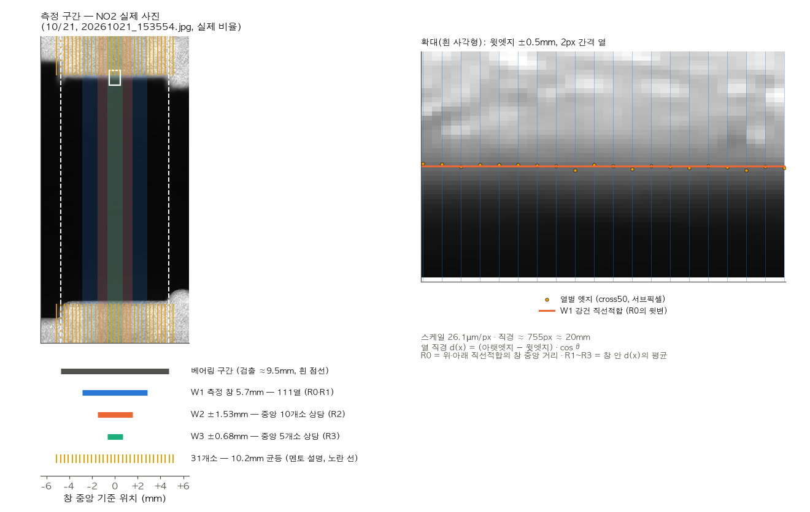
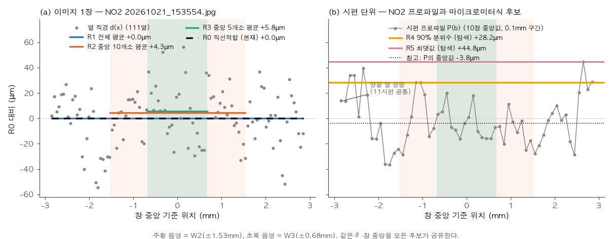
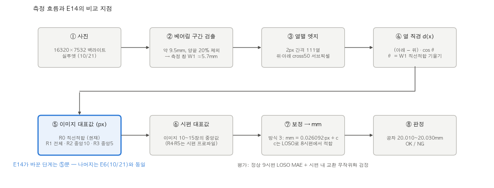
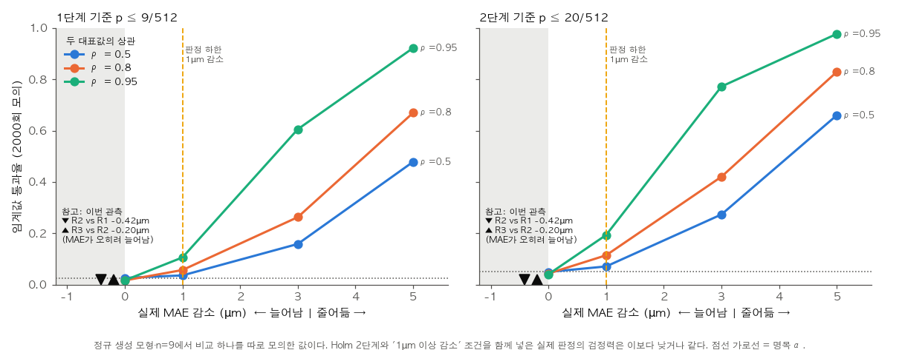
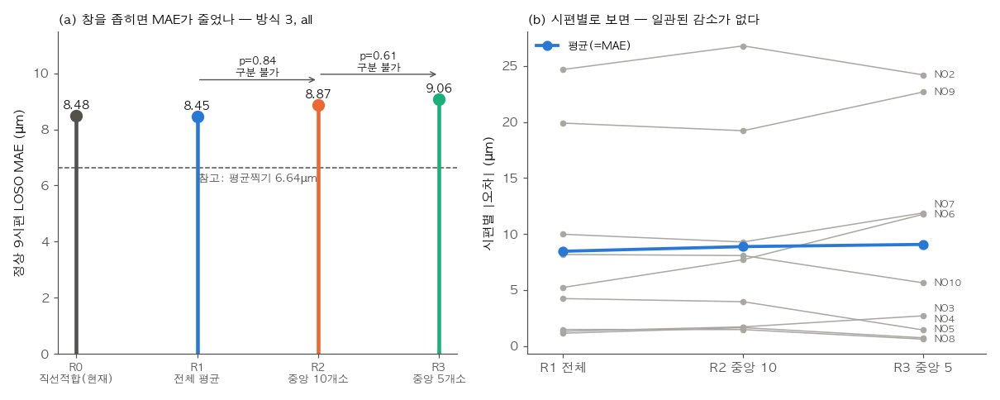
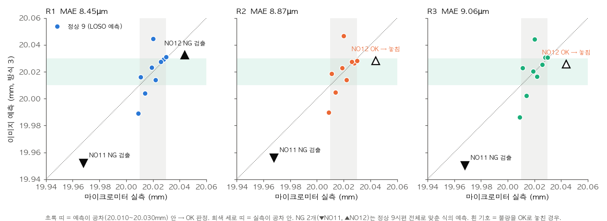
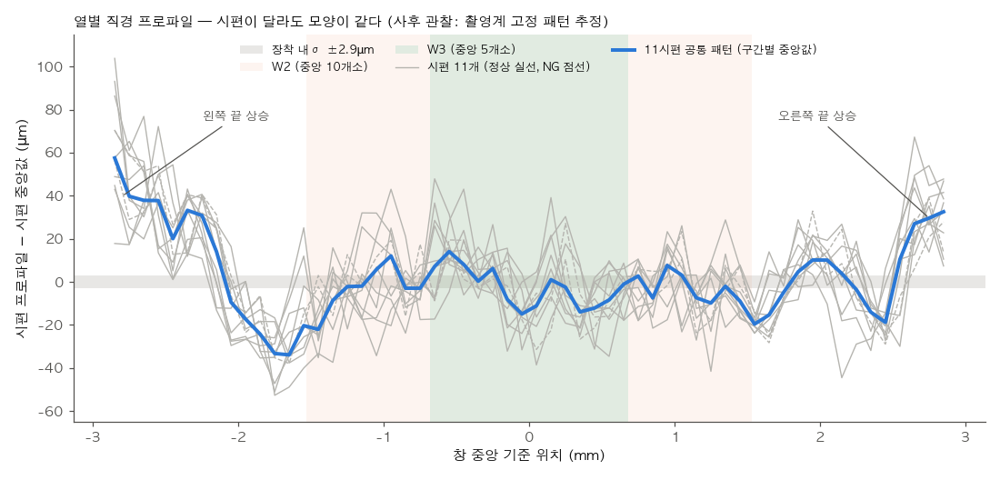

# E14 중앙 구간 대표값 — 측정 구간을 중앙으로 좁히면 마이크로미터 실측과 더 맞는가

- 작성 2026-10-31 · 브랜치 `feature/5th_expr` · 규칙 `docs/PREREG_E14.md` · 지시서 `docs/EXPERIMENTS_E14.md`
- 자료: 10/21 3차 촬영 기존 데이터만 사용(재촬영 없음). 정상 9시편(NO2\~NO10) LOSO, NG 2시편(NO11·NO12)은 예측값만.

---

## 0. 결론

**주 판정 (PREREG 5.2절):**

| 비교 | MAE (방식 3, all) | MAE 감소 | 단측 p | 보정 Holm | 판정 |
|---|---|---|---|---|---|
| R2 vs R1 (전체 평균 → 중앙 10개소 상당) | 8.45 → 8.87µm | −0.42µm | 0.84 | 기각 안 됨 | **이 자료로는 구분할 수 없다** |
| R3 vs R2 (중앙 10개소 → 5개소 상당) | 8.87 → 9.07µm | −0.20µm | 0.61 | 기각 안 됨 | **이 자료로는 구분할 수 없다** |

**멘토 질문에 대한 답:** 10/21 자료에서는 측정 구간을 중앙 10개소, 다시 5개소로 좁혀도 마이크로미터 실측과의 오차가 줄지 않았다. 점 추정으로는 오히려 조금 늘었다. 다만 정상 시편이 9개뿐이어서 작은 차이를 잡기 어렵다. 정규 생성 모형에서 MAE가 1µm 줄어드는 개별 비교가 보정 기준을 통과하는 비율은 4\~19%였다(E14-0). 두 비교를 함께 다루는 Holm 절차와 "1µm 이상 감소" 조건까지 넣은 판정 전체의 검정력은 계산하지 않았다. 따라서 "효과가 없다"가 아니라 "이 자료로는 구분할 수 없다"가 정확한 결론이다.

결론의 층위는 다음처럼 나눠 읽는다.

| 층위 | 근거 | 결론 |
|---|---|---|
| 창 폭 효과 (멘토 가설) | 주 비교 2개 | 구분 불가. 점 추정은 반대 방향 |
| 파이프라인 개선 (현재 `d_line` 대비) | 기술 비교 | 관측 MAE 감소는 R1 vs R0 0.025µm(단측 p=0.44), R3L vs R0 0.084µm(p=0.48)다. 개선도 동등성도 확증하지 않았다(동등성 검정은 하지 않음) |
| 마이크로미터 측정 기전 (접촉 폭 안 최대 직경) | — | 결론 없음 (PREREG 8절) |

**참고 (기술, 검정 없음):** 방식 3(물리 스케일 고정)·all에서 평가한 후보는 모두 MAE(8.4\~9.2µm)가 LOSO 평균찍기(6.64µm)보다 컸다. 반면 같은 자료에서 방식 4(핀비율 선형)의 R1은 3.74µm로 평균찍기보다 낮다. 결과가 보정 방식에 따라 달라진다는 뜻이다. 이번 자료로는 다음 두 가능성을 분리할 수 없다.
- 이미지에 시편 간 직경 차이(21µm 범위) 정보가 부족한 것
- 고정 스케일, 장착·촬영 변동이 그 정보를 가리는 것

---

## 1. 배경과 사전 고정

- **멘토링 (2026-10-30):**
  - 작업자는 베어링부(10.2mm) 중앙을 마이크로미터로 몇 차례 재서 대표값을 기록한다.
  - 이미지 쪽은 31개소를 평균하므로 오차가 생길 수 있다.
  - 그래서 중앙 10개소, 이어서 중앙 5개소만으로 실측과 비교해 보자는 제안이었다.
- **실측 조건 (사용자 확인):** 마이크로미터로 "중앙부분"을 쟀다는 것만 알고, 위치·횟수·각도의 수치 기록은 없다. `PREREG_E11`의 좌 2mm·우 3mm는 거칠기 측정 구간이다.
- **현재 파이프라인과의 차이:**
  - 31개소는 1차(팀 YOLO) 설정이다.
  - 10/21 파이프라인은 베어링 구간 양끝을 20%씩 잘라 중앙 약 5.7mm(110\~111열)만 쓴다.
  - 대표값은 열 평균이 아니라 강건 직선적합의 중앙 거리다.
- **사전 고정:** 후보는 계산하기 전에 PREREG를 커밋했다(`9097e5a`). Codex 리뷰를 4회 받았고, 각 리뷰의 반영 내용과 동의하지 않은 점은 PREREG 부록 A·A-2·B에 기록했다. 주요 설계 변경은 모두 후보를 계산하기 전에 했다.
  - 주 비교를 R0 대비에서 **같은 집계법(평균) 안의 R1 → R2 → R3**로 바꿨다. 창 폭 효과와 집계법 효과를 분리하기 위해서다.
  - 부호뒤집기 검정을 버리고 **시편 내 교환 무작위화 검정**으로 바꿨다. 교환 패턴마다 보정과 LOSO 전체를 다시 계산한다.
  - 귀무 모의실험에서 명목 0.05의 실제 기각률이 약 0.06으로 나왔다. 그래서 **보정 Holm 기준**(9/512 다음 20/512)을 쓴다. 사용자가 (나)안을 선택했다.
  - R4(90% 분위수)는 판정에서 빼고 탐색용 특징으로 내렸다.

| 기호 | 정의 (모두 같은 θ·창 중앙 xm 사용) |
|---|---|
| R0 | `d_line` (현재 방식, 전체 창 강건 직선적합) |
| R1 / R2 / R3 | 전체 창 / 중앙 ±1.53mm / 중앙 ±0.68mm 열 직경의 평균 |
| R2L / R3L | 중앙 창 안에서만 강건 직선적합 (현재 방식에서 창만 좁힌 것) |
| R1m\~R3m | R1\~R3의 중앙값 판 |
| R4 / R5 | 시편 프로파일(이미지 중앙값)의 90% 분위수 / 최댓값 (탐색) |

**그림 1 — 어디를 쟀나.** NO2 실제 사진(실제 비율) 위에 측정 구간을 표시했다.
- 흰 점선은 검출된 베어링 구간(약 9.5mm)이다.
- 파랑·주황·초록 띠가 W1·W2·W3다.
- 노란 선은 멘토 설명의 31개소(10.2mm 균등)다. 사진을 가리지 않도록 축 바깥 배경 쪽에만 그렸다.
- 오른쪽 확대에서 세로선은 2px 간격 열이고, 점은 열마다 잡은 윗엣지(cross50), 주황 선은 R0의 윗변 직선적합이다.
- 31개소는 10.2mm에 걸쳐 있어 검출 구간 밖까지 나간다. 반면 우리가 쓰는 W1은 그 안쪽 중앙 약 5.7mm다.



**그림 2 — 대표값을 어떻게 만드나.**
- (a) 이미지 한 장의 열 직경 d(x)(회색 점)와 각 대표값(가로선)이다. 열마다 ±20\~50µm씩 흔들리고 R0(직선적합)와 R1(평균)은 거의 같다. R2·R3는 W2·W3 안의 점만 평균한다.
- (b) 시편 단위로 10장의 중앙값 프로파일을 만들고 그 90% 분위수(R4)와 최댓값(R5)을 잡는다.



**그림 3 — 전체 흐름에서 E14가 바꾼 곳.** 사진에서 판정까지 8단계 중 E14가 바꾼 것은 ⑤ 이미지 대표값(파란 상자)뿐이다. 엣지 검출, 시편 대표값 규칙, 보정, 판정은 E6(10/21)와 같다.



---

## 2. 단계별 결과

### E14-0 데이터 준비·재현·검정 점검·검정력 (`results/E14_0_*.csv`)

- R0 재현: 최대 차이 0px. E6 LOSO 재현: 6.639 / 8.479 / 3.991µm로 모두 통과.
- 검정 구현 점검: 4가지 모두 통과.
  - A=B일 때 p=1
  - 전부 교환한 패턴에서 T가 −T_관측
  - 닫힌 식과 `calibration.py` 결과가 일치
  - 모의 검정과 `swap_test`가 패턴별로 일치
- **개별 비교의 보정 임계값 통과율** (정규 생성 모형, 두 대표값의 상관 ρ = 0.5·0.8·0.95, n=9, 각 2000회). 비교 하나를 따로 모의한 값이다. 두 주 비교를 함께 다루는 Holm 절차와 "MAE 1µm 이상 감소" 조건을 넣은 실제 판정의 검정력은 계산하지 않았다. 2단계 기준(≤20/512)은 1단계에서 기각됐을 때만 쓰인다.

| MAE 감소 | 1단계 (≤9/512) | 2단계 (≤20/512) |
|---|---|---|
| 0 (귀무) | 0.016\~0.026 | 0.040\~0.050 |
| 1µm | 0.04\~0.11 | 0.07\~0.19 |
| 3µm | 0.16\~0.61 | 0.27\~0.77 |
| 5µm | 0.48\~0.92 | 0.66\~0.98 |

**그림 7 — 왜 "구분할 수 없다"인가.** 위 표를 그린 것이다. 실제로 MAE가 1µm 줄어도(주황 점선) 임계값을 통과하는 비율은 약 0.04\~0.19에 그친다. 3\~5µm는 줄어야 통과 가능성이 커진다. 왼쪽 회색 영역의 ▼▲는 이번 관측값(R2 vs R1 −0.42µm, R3 vs R2 −0.20µm)으로, MAE가 오히려 늘어난 쪽이다. 관측값은 실제 효과의 추정치일 뿐 가로축과 같은 양이 아니어서 참고로만 표시했다.



### E14-1 프로파일·잡음/형상 진단 (`results/E14_profile*.csv`, `E14_noise_shape.csv`, `E14_window_delta.csv`, `figures/E14_profile.png`)

- **창 대비 (이미지별, 시편 중앙값):** c2(R2−R1)는 −2.2\~−6.9µm, c3(R3−R1)는 −5.6\~+3.4µm.
- **사전에 정한 해석:** |c3| 중앙값은 정상 9시편 2.71µm로 기준 2.9µm보다 작다. 따라서 기대값 수준의 휘어짐은 작다.
- **열 잡음과 형상:** σ_noise 20\~28µm(열당 약 1px), σ_shape 20\~25µm.
- **R4 편향 진단:** (R4−R1)과 σ_noise의 Spearman ρ = −0.47. 잡음이 큰 시편일수록 R4가 커진다는 신호는 없다.
- **창 축소가 MAE를 바꿀 수 있는 상한:** 실측 없이, 시편 대표값의 차이 δ로 계산한 값이다.

| 비교 | δ 시편 간 SD | \|MAE 변화\| 상한 |
|---|---|---|
| R2 − R1 | 1.67µm | 1.35µm |
| R3 − R2 | 2.87µm | 2.94µm |

- R2 vs R1은 MAE를 최대 1.35µm까지만 바꿀 수 있다. 그래서 "1µm 이상 감소하면서 유의" 조건을 결과와 무관하게 통과하기 어려운 구조였다. 실측을 보기 전에 기록한 사실이다.

### E14-2 후보 비교 (`results/E14_by_image.csv`, `E14_by_specimen.csv`, `E14_loso.csv`, `E14_tests.csv`)

정상 9시편 LOSO MAE(µm):

| 후보 | 방식 3 all | 방식 3 burst | 방식 4 all | 방식 4 burst |
|---|---|---|---|---|
| R0 | 8.48 | 8.66 | 3.99 | 4.60 |
| **R1** | **8.45** | 8.39 | **3.74** | **4.21** |
| **R2** | **8.87** | 8.68 | 5.58 | 5.37 |
| **R3** | **9.06** | 7.75 | 4.30 | 5.13 |
| R2L | 8.58 | 8.73 | 5.72 | 5.63 |
| R3L | 8.39 | 7.72 | 4.62 | 5.38 |
| R1m / R2m / R3m | 8.95 / 8.37 / 9.18 | 8.94 / 8.17 / 8.14 | 4.50 / 4.30 / 4.65 | 4.83 / 4.84 / 5.28 |
| R4 / R5 (탐색) | 10.92 / 14.95 | 7.26 / 14.90 | 4.61 / 8.27 | 5.14 / 8.15 |
| R4n / R5n (사후 민감도) | – | – | 3.26 / 8.31 | 5.00 / 8.21 |
| 참고: 평균찍기 (E6) | 6.64 | | | |

**그림 4 — 창을 좁히면 오차가 줄었나.**
- (a) 주 비교인 R1 → R2 → R3의 MAE와 p다. 좁힐수록 MAE가 조금 늘었고 두 비교 모두 구분 불가다.
- (b) 9시편 각각의 \|오차\|다. R1 → R3에서 오차가 줄어든 시편이 5개(NO4 −2.8, NO10 −2.5, NO8·NO2·NO5 −0.4\~−0.9µm), 늘어난 시편이 4개(NO6 +6.5, NO9 +2.8, NO7 +1.9, NO3 +1.4µm)라 일관된 방향이 없다.



- 기술 검정(방식 3, all)은 모두 p ≥ 0.44로, 판정에 쓰지 않는다.
- **NG 예측 (방식 3, all, 9시편 적합):** 실측은 NO11 19.968, NO12 20.044mm다.

| 대표값 | NO11 예측 (판정) | NO12 예측 (판정) |
|---|---|---|
| R0 | 19.953 (NG) | 20.034 (NG) |
| R1 | 19.952 (NG) | 20.032 (NG) |
| R2 | 19.956 (NG) | 20.028 (**OK, 불량 미검출**) |
| R3 | 19.950 (NG) | 20.026 (**OK, 불량 미검출**) |

  판정은 `calibration.judge` 기준이다(공차 20.010\~20.030mm). R0·R1에서는 NG 2개를 모두 잡지만 창을 좁힌 R2·R3에서는 NO12(실측 20.044mm)의 예측이 공차 안으로 들어와 불량을 놓친다. NG 시편이 2개뿐이라 이것으로 검출 성능을 추정할 수는 없지만 관측된 방향은 멘토 가설에 불리하다.

**그림 5 — 실측 vs 예측.**
- 초록 띠는 예측이 공차 안에 들어 OK로 판정되는 범위다.
- 점선(y = x)에 가까울수록 정확하다.
- R2·R3에서 NO12(▲)가 초록 띠 안으로 들어와 흰 기호, 즉 불량을 놓친 경우가 된다.



---

## 3. 사후 관찰 (사전 등록 밖 — 결론에 쓰지 않음)

1. **열별 직경 프로파일은 시편과 무관한 공통 패턴이 지배한다.**
   - 11시편 프로파일과 공통 패턴의 상관은 0.73\~0.87이다. 공통 패턴의 SD는 18.9µm이고 시편 고유 성분의 SD는 10\~16µm다.
   - 양끝 3열은 +16\~+72µm 높게 잡힌다.
   - 서로 다른 축이 같은 형상을 보이므로, 이 패턴은 축 형상보다 촬영계 쪽 고정 패턴일 가능성이 크다. E11-A의 "끝열 급락 = 사진 쪽 고정 위치 아티팩트"와 같은 방향이다.
   - 공통 패턴은 방식 3의 상수 c가 흡수한다. 그래서 창 축소의 효과는 시편 간 δ 변동(위 상한)으로 제한된다.

   **그림 6.** 회색은 시편 11개, 파랑은 11시편 공통 패턴이다. 시편이 달라도 곡선 모양이 거의 겹치고 양끝이 함께 올라간다.

   
2. **재장착 후 형상 재현이 떨어진다.**
   - 같은 꼴로 비교하면, 본시험 이미지 1장 vs 나머지 이미지의 상관은 0.73\~0.84인데, 재장착 이미지 1장 vs 본시험의 상관은 0.12\~0.66이다. ±0.5mm 정합을 적용해도 재장착 상관은 0.26\~0.70으로 조금만 회복된다.
   - 독립 장착 반복 자료가 없어서, 창 좌표 이동·실제 변화·촬영 의존성 중 무엇이 원인인지 분리할 수 없다.
3. **burst와 all의 순위가 다르다.**
   - 재장착 이미지를 더하면 방식 3 MAE가 R3 +1.32, R3L +0.67, R4 +3.66µm 늘었다.
   - 재장착이 있는 정상 시편은 NO7\~NO10뿐이라, 재장착 효과와 표본 변동을 구분할 수 없다.
4. **R4n(이미지별 핀 정규화 후 분위수)은 방식 4 all에서 3.26µm로 R1보다 낮다.** 그러나 이것을 "마이크로미터식 대표값이 낫다"는 근거로 쓰지 않는다.
   - 결과를 본 뒤 추가한 행이다.
   - burst에서는 순위가 반대다.
   - 방식 4는 8점으로 기울기를 적합해 불안정하다.
   - 이 비교에는 검정이 없다.

---

## 4. 한계

- **측정 창 밖을 보지 못했다.** 열 캐시는 중앙 약 5.7mm만 담고 있다. 마이크로미터 접촉 폭(일반 규격 6.35mm)이나 10.2mm 전체는 원본 이미지를 다시 측정해야 한다.
- **실측 조건 기록이 없다.** 마이크로미터의 측정 위치·횟수·각도 기록이 없고 기종도 확인하지 않았다. 원주 방향 각도에 따라 직경이 다르면 그 차이는 이 분석에서 보이지 않는다.
- **n = 9, 검정력이 낮다.** 1µm 감소에서 개별 비교의 보정 임계값 통과율은 4\~19%다(E14-0, 정규 모형). Holm과 1µm 조건을 함께 넣은 실제 판정의 검정력은 계산하지 않았다.
- **NG 시편이 2개뿐이다.** NG 예측과 판정은 사례 관찰일 뿐이며, 검출 성능(민감도)을 추정하지 못한다.
- **R0 대비 비교는 기술 통계다.** 큰 p는 동등성을 뜻하지 않는다.
- **검정이 기대는 가정:**
  - 교환가능성: 중심화한 두 대표값이 시편 안에서 교환가능하다.
  - 보정 기준의 생성 모형: 정규분포, 같은 SD를 가정했다. 실제 열 잡음 분포가 이와 다르면 실제 1종 오류율도 달라질 수 있다.
- **E6 수치를 미리 봤다.** R0의 LOSO 결과는 PREREG 0절에 공개했고 재현 확인과 검정력 입력으로만 썼다.

---

## 폴더 구성

| 경로 | 내용 |
|---|---|
| `code/paths.py` | 경로 |
| `code/e14.py` | `--step 0/1/2` |
| `results/E14_0_checks.csv`, `E14_0_power.csv` | 재현·검정 점검, 검정력 |
| `results/E14_profile.csv`, `E14_profile_contrast.csv`, `E14_noise_shape.csv`, `E14_window_delta.csv` | E14-1 |
| `results/E14_by_image.csv`, `E14_by_specimen.csv`, `E14_loso.csv`, `E14_tests.csv` | E14-2 |
| `figures/E14_fig1_overlay.png` | 그림 1: 실제 사진 위 측정 구간 (원본 사진 축소·크롭, 시각화 전용) |
| `figures/E14_fig2_representatives.png` | 그림 2: 대표값 만드는 법 |
| `figures/E14_fig3_pipeline.png` | 그림 3: 측정 흐름과 E14가 바꾼 단계 |
| `figures/E14_fig4_mae.png`, `E14_fig5_pred_vs_true.png` | 그림 4·5: 결과 |
| `figures/E14_profile.png` | 그림 6: 시편 프로파일과 공통 패턴 (E14-1 그림을 `--step 3`이 다시 그림) |
| `figures/E14_fig7_power.png` | 그림 7: 개별 비교의 보정 임계값 통과율과 이번 관측값 |

## 재현 순서

```bash
# edges_long.csv.gz가 없으면: cd experiments/3rd/roughness/code && python3 load_edges.py   (E11_PROFILES 환경변수로 npz 경로 지정 가능)
cd experiments/5th/E14_center_window/code
/usr/bin/python3 e14.py --step 0   # ~5초
/usr/bin/python3 e14.py --step 1   # ~10초
/usr/bin/python3 e14.py --step 2   # ~16초
/usr/bin/python3 e14.py --step 3   # 보고서 그림. 그림 1은 원본 사진 필요(SHAFT_1021_DATA 환경변수로 경로 지정)
```

- 그림 1의 원본 사진은 EXIF 회전(orientation 3 = 180°)을 적용해서 읽는다. 측정에 쓴 `cv2.imread`와 좌표계를 맞추기 위해서다.

- 환경: `/usr/bin/python3` 3.9.6, numpy 2.0.2, pandas 2.3.3, matplotlib 3.9.4. CPU만 쓰고 시드는 42다.
- numpy `multivariate_normal`의 matmul RuntimeWarning과 pandas `groupby.apply`의 FutureWarning은 결과에 영향이 없다. 모의 MAE 감소량과 귀무 기각률이 정상 범위로 나오는 것을 확인했다.
